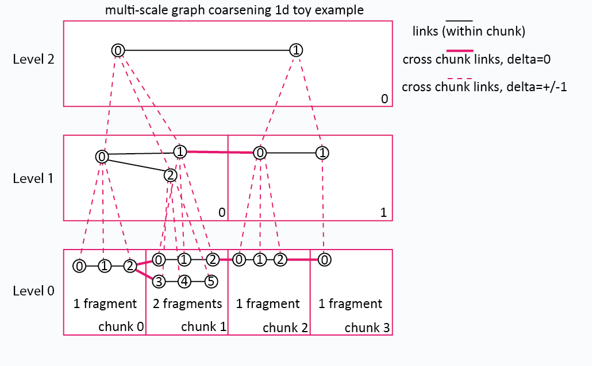

# 9. Multi-Resolution Support

## 9.1 Resolution Level Structure

Each pyramid level is a bare-integer sub-group of the root: `0/` is
full resolution, `1/`, `2/`, … are coarser.  The level group's
`zarr_vectors` object (`kind: "level"`,
[§8.3](08-metadata.md#83-resolution-level-metadata)) carries the level
index, vertex count, source level (`parent_level`), and above level 0
the bin grid (`bin_shape`, `bin_ratio`) and an optional `chunk_shape`.

Levels are independent Zarr groups, so a reader of one level fetches
only that level's data.  Axes, bounds, the `proj:projjson` CRS and the
root's convention registrations are root-only.

### The `multiscales` block

The root lists the levels in a `multiscales` attribute laid out by the
[multiscales convention](https://github.com/zarr-conventions/multiscales)
v0.1, which the root registers in `zarr_conventions` (uuid
`d35379db-88df-4056-af3a-620245f8e347`).  It has one `layout` entry per
level, in ascending order, whose `asset` is the level group's name;
`"0"` is always present:

```json
"multiscales": {
  "layout": [
    {"asset": "0"},
    {"asset": "1"},
    {"asset": "2"}
  ]
}
```

The block holds nothing else.  Vertex positions are in level-0
coordinates at every level, so no transform relates the levels: a
writer MUST NOT write a `transform`, and a reader MUST NOT apply one.
Axes are in the root `zarr_vectors.axes`, and a coarse level's bins only
in its level object ([§9.3](#93-spatial-chunk-scaling)).  A writer keeps
any other keys already present in an entry.

## 9.2 Downsampling Strategies



The level's `coarsening_method` records how it was made:

| Value | Meaning |
|-------|---------|
| `"none"` | Level 0 |
| `"per_object"` | Per-object coarsening, below (the default for coarse levels) |
| `"manual"` | A caller-supplied method (e.g. mesh decimation, skeleton path simplification); only the standard level invariants apply |

**Per-object coarsening.**  Each level-0 fragment maps to a coarse bin
via `bin_ratio`.  Per object and coarse bin, the contributing vertices
reduce to one **metavertex** (centroid, mean or mode, by writer), and
per-vertex attributes reduce the same way.  The object's coarse
fragment holds the metavertices; their parent links are in `links/+1/`
when emitted ([§9.6](#96-multiscale-link-arrays--optional)).

Per-object pyramids keep object ids: a dropped object keeps its id with
an empty manifest.  Such levels set `preserves_object_ids = true` and
`inherited_num_objects` (the parent level's id-space size), and
`object_sparsity` records the fraction of the parent's objects kept.

**Shared metavertices.**  A coarse metavertex may be named by several
objects' manifests (e.g. two streamlines through one coarse bin).
Such levels set `shared_fragments = true`, and the root lists the
`shared_fragments` capability.

## 9.3 Spatial Chunk Scaling

A level MAY override the root `chunk_shape` with its own, subject to:

- **Nested grids**: per axis, a positive integer multiple `r_i` of the
  root `chunk_shape`.  A level-N chunk covers `∏ r_i` level-0 chunks.
- **Bin compatibility**: where the level's bin is not larger than its
  chunk, the chunk shape MUST be a multiple of the bin shape.  A coarse
  bin MAY be larger than its chunk.

`chunk_scale_factor(root_meta, level_meta)` gives `(r_0, …,
r_{ndim-1})`, and `coord_level = coord_0 // r`.  A level without
`chunk_shape` uses the root's.

### Bin geometry lives in the level object

| Level | `bin_shape` | `bin_ratio` |
|-------|-------------|-------------|
| 0 | not stored: root `base_bin_shape` (or `chunk_shape`) | not stored: 1 |
| > 0 | the level's bin shape | `bin_shape / base_bin_shape`, per axis |

Level 1 of a streamline pyramid (`chunk_shape` 200, default bin):

```json
{
  "zarr_conventions": [{"uuid": "66268a61-7833-4995-bbcb-233bb417dae5"}],
  "zarr_vectors": {
    "kind": "level",
    "level": 1,
    "object_sparsity": 0.5,
    "vertex_count": 1,
    "coarsening_method": "per_object",
    "parent_level": 0,
    "arrays_present": ["links", "object_index", "vertex_fragments", "vertices"],
    "preserves_object_ids": true,
    "inherited_num_objects": 20,
    "shared_fragments": true,
    "bin_ratio": [2.0, 2.0, 2.0],
    "bin_shape": [400.0, 400.0, 400.0]
  }
}
```

A coarse level recording neither key reads as level 0's.  `bin_ratio`
is measured against level 0, not the parent (coarsening by 2 twice
gives 2, then 4).  It is a float with no integer requirement and MUST
NOT be rounded, so fractional factors round-trip.  When both keys are
present they MUST agree.  A writer MUST NOT change `chunk_shape`,
`bin_shape` or `bin_ratio` on a populated level.

## 9.4 Level-of-Detail Selection

Readers choose a level by vertex budget (the coarsest level whose
`vertex_count` fits), by pixel size (for a per-object pyramid, level
N's metavertex spacing is its `bin_shape`), or by index.  The root
`reduction_factor` says adjacent levels differ by at least that factor
in vertex count.

## 9.5 Consistency Across Levels

- Root-only and shared by every level: `bounds`, `axes`, the
  `proj:projjson` CRS, `geometry_types`, convention registrations.
- Vertex coordinates are level-0 coordinates at every level.
- `bin_shape` / `bin_ratio` and `chunk_shape` are per-level overrides;
  level 0 takes both from the root.
- Per-object pyramids preserve the object-id space; dropped objects
  keep empty manifest rows.
- Cross-level links live in `links/<delta>/<offsets>/`
  ([§10.6](10-cross-chunk-linking.md#106-on-disk-layout-the-links-family)),
  with endpoint 0 at the owning level and endpoints `k > 0` at
  `owning + delta`.

## 9.6 Multiscale Link Arrays — Optional

Arrays under `links/<delta>/` and `link_attributes/<name>/<delta>/`
with `delta ≠ 0` link vertices across pyramid levels.  They are
optional.  They enable fragment-level LOD swapping, provenance (which
fine vertices fed a metavertex) and drill-down from a coarse object to
its fine fragments.  Without them, each level is an independent
simplification.

```text
links/<delta>/<offsets>/<chunk>
link_attributes/<name>/<delta>/<offsets>/<chunk>
```

`<delta> = 0` holds same-level links and is required whenever the
geometry has explicit links.  `<offsets>` locates the other endpoints
relative to the source chunk
([§10.6.3](10-cross-chunk-linking.md#1063-the-offsets-segment)); under
`delta ≠ 0` it is measured from the source chunk re-anchored into the
target level's grid
([§10.8](10-cross-chunk-linking.md#108-cross-pyramid-level-links--optional)).

A store with any `delta ≠ 0` array lists the `multiscale_links`
capability.  A reader that does not support it MUST treat coarser
levels as independent simplifications.

### Storage knobs

| Root key | Values |
|----------|--------|
| `cross_level_storage` | `"none"`: no cross-level arrays.  `"implicit"`: only `+N` at the finer level (the inverse is computed at read time).  `"explicit"` (default): `+N` at the finer level and `-N` at the coarser |
| `cross_level_depth` | Largest absolute delta materialized: `1` (default) for adjacent levels, `N` for ±1 … ±N, `0` none, `-1` all |

### Reading the pyramid via multiscale links

To find the parent metavertex at level L+1 of a vertex in chunk `c` at
level L:

1. Read cell `c` of each array under level L's `links/+1/` (for
   `link_width = 1`, the single `self` segment).
2. Endpoint `k > 0` of each record is row `v'` of level-L+1 chunk
   `anchor + o_k`, where `anchor` is `c` re-anchored into the level-L+1
   grid and `o_k` comes from the offsets segment.

`-1` traversal is the same under `cross_level_storage = "explicit"`.
Deeper steps compose, or read a materialized `+2`, `+3`, … up to
`cross_level_depth`.
