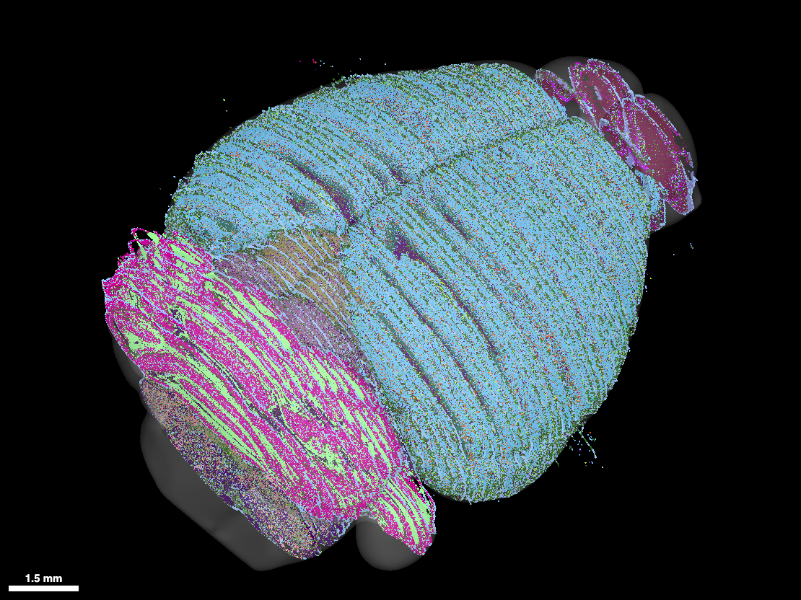
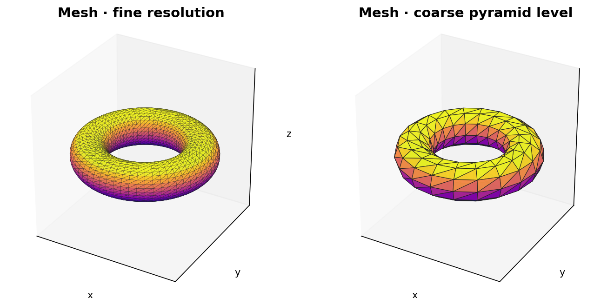
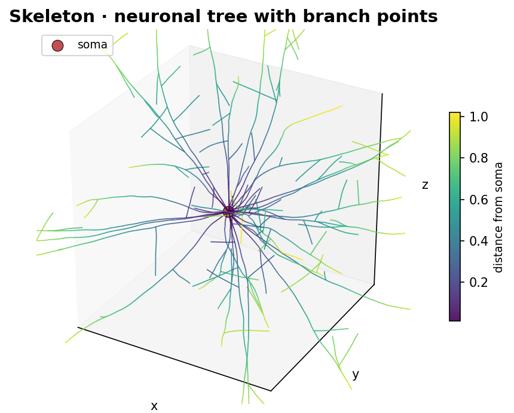
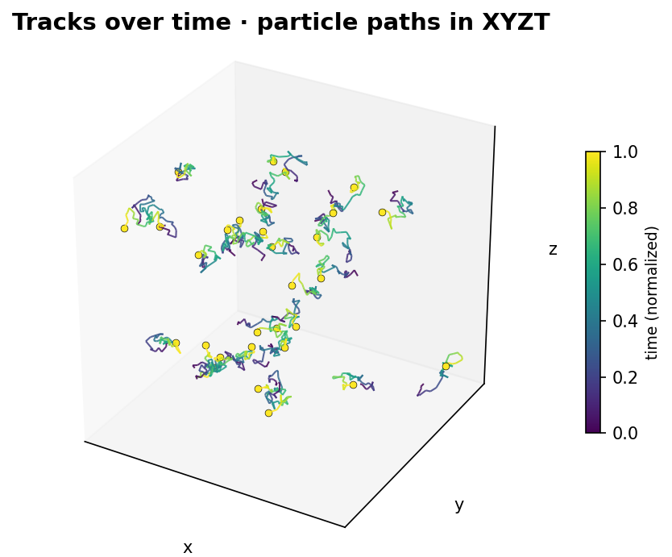
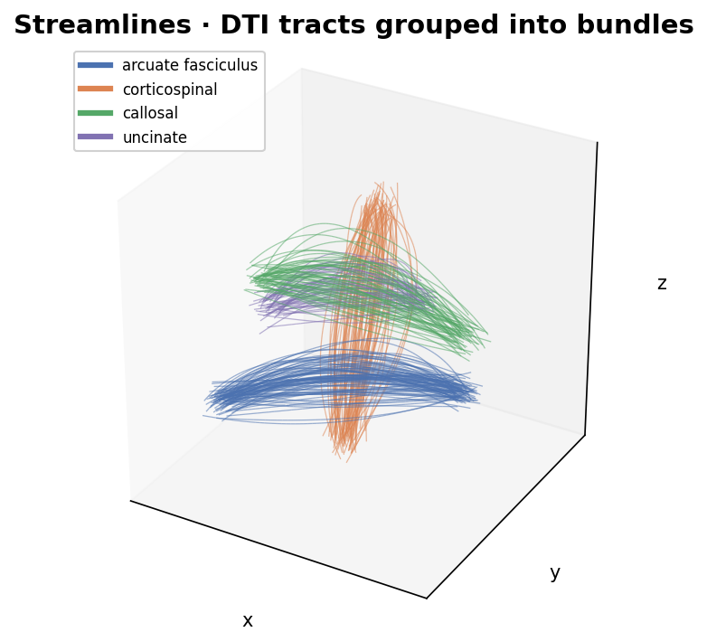

# 14. Examples

Concrete store layouts for the data model.  Directory trees show the
Zarr v3 groups and arrays; cells sit at `c/<i>/<j>/<k>` on the chunk
grid.  JSON snippets are node `attributes` written by the reference
implementation (zarr-vectors-py, format 0.10.0), cut where marked `…`:

- `zarr_conventions` is shown once, in §14.1.  Every other node carries
  `"zarr_conventions": [{"uuid": "66268a61-7833-4995-bbcb-233bb417dae5"}]`
  beside its `zarr_vectors` object.
- `nonempty_chunks` lists are shortened, and the root's `ome` node is
  omitted.
- Standard Zarr fields (`shape`, `chunk_grid`, `codecs`, …) are omitted
  except in §14.11.

---

## 14.1 Mouse Brain Nuclei: Point Cloud with Multi-Resolution and Regions



**Use case**: nucleus centroids from a cleared mouse brain.  Each
nucleus is an object with a volume attribute; nuclei are grouped by
brain region; a pyramid supports coarse-to-fine viewing.

```
mouse_brain_nuclei.zarrvectors/
├── zarr.json                              # root: zarr_vectors, multiscales, ome
├── 0/
│   ├── zarr.json                          # kind "level"
│   ├── vertices/                          # kind "vertices"; c/0/0/0, …
│   ├── vertex_fragments/                  # kind "vertex_fragments"
│   ├── vertex_attributes/volume/          # kind "vertex_attribute"; µm³
│   ├── object_index/                      # kind "object_index"
│   │   ├── manifests                      # one manifest blob per nucleus
│   │   └── object_ids
│   ├── links/+1/0.0.0/                    # fine → coarse metavertex links
│   ├── groups                             # kind "groups"; G regions → object ids
│   └── group_attributes/region_id         # kind "group_attribute"; (G,)
├── 1/                                     # bin_shape 100; same OID space
│   ├── zarr.json
│   ├── vertices/, vertex_fragments/, object_index/
│   └── links/+1/, links/-1/
└── 2/                                     # bin_shape 200
```

**Root attributes**:

```javascript
{
  "zarr_conventions": [
    {
      "schema_url": "https://raw.githubusercontent.com/AllenInstitute/zarr-vectors-convention/refs/tags/v0.1.0/schema.json",
      "spec_url": "https://github.com/AllenInstitute/zarr-vectors-convention/blob/v0.1.0/README.md",
      "uuid": "66268a61-7833-4995-bbcb-233bb417dae5", "name": "zarr_vectors",
      "description": "Spatially chunked, multi-resolution N-dimensional vector data (point clouds, meshes, skeletons, streamlines, graphs)"
    },
    {
      "schema_url": "https://raw.githubusercontent.com/zarr-conventions/multiscales/refs/tags/v0.1/schema.json",
      "spec_url": "https://github.com/zarr-conventions/multiscales/blob/v0.1/README.md",
      "uuid": "d35379db-88df-4056-af3a-620245f8e347", "name": "multiscales",
      "description": "Multiscale layout of zarr datasets"
    }
  ],
  "zarr_vectors": {
    "kind": "root", "zv_version": "0.10.0",
    "axes": [
      {"name": "x", "type": "space"}, {"name": "y", "type": "space"},
      {"name": "z", "type": "space"}
    ],
    "format_capabilities": [
      "preserved_object_ids", "shared_fragments", "multiscale_links"
    ],
    "chunk_shape": [200.0, 200.0, 200.0], "bounds": [[0, 0, 0], [1000, 1000, 1000]],
    "geometry_types": ["point_cloud"], "base_bin_shape": [50.0, 50.0, 50.0],
    "object_index_convention": "standard", "cross_chunk_strategy": "explicit_links",
    "cross_level_depth": 1, "cross_level_storage": "explicit"
  },
  "multiscales": {"layout": [{"asset": "0"}, {"asset": "1"}, {"asset": "2"}]},
  "ome": {
    "version": "0.6", "type": "collection", "name": "mouse_brain_nuclei", ...
  }
}
```

**Level 1** (`1/zarr.json`).  Its bins live here and nowhere else:

```javascript
{
  "zarr_vectors": {
    "kind": "level", "level": 1, "object_sparsity": 0.5, "vertex_count": 171,
    "coarsening_method": "per_object", "parent_level": 0,
    "arrays_present": ["links", "object_index", "vertex_fragments", "vertices"],
    "preserves_object_ids": true, "inherited_num_objects": 400,
    "shared_fragments": true, "bin_ratio": [2.0, 2.0, 2.0],
    "bin_shape": [100.0, 100.0, 100.0]
  }
}
```

**Arrays** (`0/vertex_attributes/volume`, `0/object_index`, `0/groups`):

```javascript
{"zarr_vectors": {"kind": "vertex_attribute", "nonempty_chunks": ["0.0.0", "0.0.1", ...],
                  "name": "volume", "dtype": "float32", "row_shape": []}}
{"zarr_vectors": {"kind": "object_index", "num_objects": 400, "num_present": 400,
                  "sid_ndim": 3, "layout": "vlen_manifests_v2", "object_ids_sorted": true}}
{"zarr_vectors": {"kind": "groups", "num_groups": 2}}
```

**Notes**:

- One nucleus per object, one fragment per nucleus: a length-1 range
  `(start, 1)` in `vertex_fragments/<chunk>`, referenced by one mode-0
  manifest block `(chunk_coords, mode=0, fragment_index=k)`.  The
  fragment index is what lets a manifest name a nucleus by chunk-local
  position, with no global vertex IDs.
- Without per-nucleus identity, the writer instead makes one fragment
  per bin (`200/50 = 4` per axis → 64 per chunk) and no `object_index/`;
  the fragment index is then only a sub-chunk spatial filter.
- `bounds` max is inclusive of the last chunk: `[0, 1000]` with chunk 200
  gives a grid of 6 per axis.
- `+1` / `-1` cross-level link arrays drill between levels
  ([§9.6](09-multi-resolution-support.md#96-multiscale-link-arrays--optional)).

---

## 14.2 Mesh with Multi-Resolution (chunk-scale growth)



**Use case**: a triangulated surface (e.g. a Drosophila brain
compartment).  Coarser levels grow the chunk shape so each coarse chunk
covers `2³` fine chunks.

```
drosophila_central_complex_mesh.zarrvectors/
├── zarr.json                              # geometry_types ["mesh"], links_convention "explicit"
├── 0/
│   ├── zarr.json                          # chunk_shape inherits root
│   ├── vertices/                          # encoding "raw" (or "draco")
│   ├── vertex_fragments/
│   ├── links/0/                           # kind "links_family", link_width 3
│   │   ├── 0.0.0_0.0.0/                   # faces inside one chunk
│   │   ├── 0.0.+1_0.0.+1/                 # faces straddling the +z seam
│   │   └── 0.0.+1_0.+1.0/                 # faces spanning three chunks
│   ├── link_fragments/                    # partitions links/0/0.0.0_0.0.0 only
│   └── object_index/
└── 1/                                     # chunk_shape = 2× root per axis
    ├── zarr.json
    ├── vertices/, vertex_fragments/, object_index/
    └── links/-1/                          # coarse → fine mapping
```

**Level 1**:

```javascript
{
  "zarr_vectors": {
    "kind": "level", "level": 1, "object_sparsity": 1.0, "vertex_count": 9,
    "coarsening_method": "per_object", "parent_level": 0,
    "arrays_present": ["links", "object_index", "vertex_fragments", "vertices"],
    "chunk_shape": [400.0, 400.0, 400.0], "preserves_object_ids": true,
    "inherited_num_objects": 1, "shared_fragments": true, "bin_ratio": [2.0, 2.0, 2.0],
    "bin_shape": [400.0, 400.0, 400.0]
  }
}
```

**Face family** (`0/links/0`) and a seam array (`0/links/0/+1.0.0_+1.0.0`):

```javascript
{"zarr_vectors": {"kind": "links_family", "level_delta": 0, "link_width": 3,
                  "directed": false, "store": "canonical", "sid_ndim": 3,
                  "num_links": 800, "num_physical_records": 800}}
{"zarr_vectors": {"kind": "links", "nonempty_chunks": [ ... ], "dtype": "int64",
                  "offsets": [[1, 0, 0], [1, 0, 0]], "has_perm": true,
                  "link_width": 3, "level_delta": 0}}
```

**Notes**:

- `arrays_present` lists family names only.
- Seam arrays in an undirected family carry `perm_idx` (`has_perm:
  true`), which restores each face's written winding.
- The grids nest: level-0 chunk `(2,3,4)` lies in level-1 chunk
  `(1,1,2)`.
- A `+1` / `-1` record sits in its source chunk's cell, and its offsets
  locate the other endpoint relative to that chunk **re-anchored into the
  other level's grid**, so chunk-scale growth does not scatter one
  relationship across many offsets segments
  ([§9.6](09-multi-resolution-support.md#96-multiscale-link-arrays--optional)).

---

## 14.3 Skeleton with Cross-Chunk Objects



**Use case**: neuronal skeletons in a large volume; each neuron is one
object spanning many chunks.  Parent edges (`link_width = 2`) form a
tree; most parents are sequential (`parent = i − 1`).

```
mouse_cortex_skeletons.zarrvectors/
├── zarr.json                              # links_convention "implicit_sequential_with_branches"
├── 0/
│   ├── zarr.json
│   ├── vertices/, vertex_fragments/       # one fragment per neuron piece per chunk
│   ├── links/0/                           # link_width 2
│   │   ├── 0.0.0/                         # branch links inside one chunk
│   │   └── 0.0.+1/                        # parent→child across the +z seam
│   ├── link_fragments/                    # partitions links/0/0.0.0 only
│   ├── vertex_attributes/
│   │   ├── vertex_type/                   # uint8: 1 soma, 2 axon, 3 dendrite
│   │   └── radius/                        # µm
│   └── object_index/                      # B = number of neurons
└── 1/ …                                   # per-object pyramid
```

**Root object** and **parent-edge family**:

```javascript
{
  "kind": "root", "zv_version": "0.10.0", "format_capabilities": [],
  "geometry_types": ["skeleton"],
  "links_convention": "implicit_sequential_with_branches",
  "object_index_convention": "standard", "cross_chunk_strategy": "explicit_links",
  ...
}
```

```javascript
{
  "zarr_vectors": {
    "kind": "links_family", "level_delta": 0, "link_width": 2, "directed": false,
    "store": "canonical", "sid_ndim": 3, "num_links": 67, "num_physical_records": 67
  }
}
```

**Notes**:

- Implicit sequential parents leave `links/0/0.0.0` with only branch
  links: ~50 rows for a 10k-vertex neuron with 50 branches.  Edges that
  leave a chunk are always written.
- Neuron 42 might own fragment 3 of chunk `2.1.0` and fragment 0 of
  `2.1.1`; its manifest is then two mode-0 blocks.
- A parent in `(2,1,0)` with its child one step along `+z` is one record
  `(parent_vi, child_vi)` in the `links/0/0.0.+1` cell at `(2,1,0)`.
  This family is undirected, so the record also carries `perm_idx`; a
  writer that streams one chunk at a time writes `"directed": true` and
  stores the order verbatim.

---

## 14.4 2-D Polylines with Attributes

**Use case**: blood-vessel centrelines in a 2-D slice, with radius per
vertex.

```
retina_vessels_2d.zarrvectors/
├── zarr.json
├── 0/
│   ├── zarr.json
│   ├── vertices/, vertex_fragments/       # c/0/0, …
│   ├── links/0/                           # only where a vessel crosses a chunk
│   │   ├── 0.+1/
│   │   └── +1.0/, +1.-1/, +1.+1/
│   ├── vertex_attributes/radius/
│   └── object_index/
└── …
```

**Root object**:

```javascript
{
  "kind": "root", "zv_version": "0.10.0",
  "axes": [{"name": "x", "type": "space"}, {"name": "y", "type": "space"}],
  "format_capabilities": [], "chunk_shape": [512.0, 512.0],
  "bounds": [[0, 0], [2048, 2048]], "geometry_types": ["polyline"],
  "links_convention": "implicit_sequential", "object_index_convention": "standard",
  "cross_chunk_strategy": "explicit_links"
}
```

One object per vessel, with one manifest block per chunk it passes
through.  Offsets segments have two components (`0.+1`), matching
`sid_ndim = 2`.

---

## 14.5 Time-Series Point Cloud (XYZT)



**Use case**: spots tracked in 3-D over time.

```
cell_tracks_xyzt.zarrvectors/
├── zarr.json
├── 0/
│   ├── vertices/                          # 4-D chunk grid: c/<t>/<z>/<y>/<x>
│   ├── vertex_fragments/
│   └── object_index/                      # one object = one track across t-chunks
└── …
```

**Root object**:

```javascript
{
  "kind": "root", "zv_version": "0.10.0",
  "axes": [
    {"name": "t", "type": "time", "unit": "second"},
    {"name": "z", "type": "space", "unit": "micrometer"},
    {"name": "y", "type": "space", "unit": "micrometer"},
    {"name": "x", "type": "space", "unit": "micrometer"}
  ],
  "format_capabilities": [], "chunk_shape": [10.0, 128.0, 128.0, 128.0],
  "bounds": [[0, 0, 0, 0], [100, 512, 512, 512]], "geometry_types": ["point_cloud"]
}
```

Axes follow the order `time → channel → custom → space`.  The time axis
is part of the spatial index (`sid_ndim = 4`) and is chunked like the
others, so a time-range query reads only the relevant `t` chunks.

---

## 14.6 Multiplexed FISH: Gene Measurements and Cell Types

**Use case**: MERFISH / seqFISH.  Each vertex is a cell centroid with
gene counts (many channels) and a cell type; objects are cells; groups
are cell-type clusters.

```
merfish_celltype.zarrvectors/
├── zarr.json
├── 0/
│   ├── vertices/, vertex_fragments/       # XY cell positions
│   ├── vertex_attributes/
│   │   ├── gene_expression/               # row_shape [num_genes]
│   │   └── cell_type/                     # uint16
│   ├── object_index/
│   ├── groups                             # G cell-type clusters
│   └── group_attributes/
│       ├── cell_type_name
│       └── super_type                     # e.g. "neuron", "glia"
└── …
```

**A multi-channel vertex attribute** (three channels shown; with no
names given, the writer labels them `ch0 …`):

```javascript
{"zarr_vectors": {"kind": "vertex_attribute", "nonempty_chunks": ["0.0.0", ...],
                  "name": "expr", "dtype": "float32",
                  "channel_names": ["ch0", "ch1", "ch2"], "row_shape": [3]}}
```

`row_shape` gives the column count; `channel_names` are only labels.
When the gene axis is large, a level can be chunked by an attribute,
which adds a leading bin axis to every per-chunk array and records it in
the level object
([§8.3](08-metadata.md#83-resolution-level-metadata)):

```javascript
{
  "zarr_vectors": {
    "kind": "level", "chunk_dims": ["gene", "x", "y", "z"],
    "chunk_attribute_name": "gene",
    "chunk_attribute_values": ["Gad1", "Pvalb", "Slc17a7"], ...
  }
}
```

Hierarchical typing (`super_type`) is a group attribute, not a tree.

---

## 14.7 Individual Gene Detections in mFISH (Spots → Cells)

**Use case**: each vertex is one transcript spot; spots agglomerate into
cells (objects), many spots per cell.

```
mfish_spots_cells.zarrvectors/
├── zarr.json
├── 0/
│   ├── vertices/, vertex_fragments/       # XYZ per spot
│   ├── vertex_attributes/
│   │   ├── gene_id/, intensity/, round/
│   ├── object_index/                      # one object per cell
│   ├── object_attributes/
│   │   ├── cell_type                      # (B,)
│   │   └── centroid                       # (B, 3)
│   └── groups                             # optional cell-type clusters
└── …
```

**`object_attributes/centroid`**:

```javascript
{
  "zarr_vectors": {
    "kind": "object_attribute", "name": "centroid", "dtype": "float32",
    "shape": [20, 3], "fill_sentinel_meaning": "absent"
  }
}
```

A cell spanning chunks gets one manifest block per chunk; within a chunk
its spots are a range (mode 1) or an explicit list (mode 2).  A cell with
no centroid reads back as the array's `fill_value` (NaN), not a zero
row.  With many cells, the dense object index (§14.11) avoids one byte
blob per cell.

---

## 14.8 Simple DTI: Small Volume (TRX-Aligned)

**Use case**: a small tractography dataset where spatial chunking is
unnecessary.  The store has one spatial chunk and aligns with the
[TRX format](https://tee-ar-ex.github.io/trx-python/stable/trx_specifications.html).

| TRX                                  | Zarr Vectors                                             |
|--------------------------------------|----------------------------------------------------------|
| `positions` (NB_VERTICES × 3)        | `vertices` (single cell)                                 |
| `offsets`                            | `vertex_fragments/<chunk>` (one range per streamline)    |
| `dpv` (data_per_vertex)              | `vertex_attributes/<name>/<chunk>`                       |
| `dps` (data_per_streamline)          | `object_attributes/<name>`                               |
| `groups`                             | `groups` (object IDs per tract)                          |
| `dpg` (data_per_group)               | `group_attributes/<name>`                                |
| `header.json`                        | root `zarr_vectors` (axes, bounds) and `proj:projjson`   |

```
dti_small.trx.zarrvectors/
├── zarr.json                              # object_index_convention "identity"
└── 0/
    ├── vertices/c/0/0/0                   # all positions in one cell
    ├── vertex_fragments/c/0/0/0           # ranges = TRX offsets
    ├── vertex_attributes/fa/, color/      # color: row_shape [3], uint8
    ├── object_attributes/algo, clusters_QB, commit_weights
    ├── groups                             # G tracts → streamline ids
    └── group_attributes/tract_name, mean_fa, shuffle_colors, volume
```

**Root object** and **a group attribute**:

```javascript
{
  "kind": "root", "zv_version": "0.10.0",
  "axes": [
    {"name": "x", "type": "space", "unit": "millimeter"},
    {"name": "y", "type": "space", "unit": "millimeter"},
    {"name": "z", "type": "space", "unit": "millimeter"}
  ],
  "format_capabilities": [], "chunk_shape": [100.0, 100.0, 100.0],
  "bounds": [[0, 0, 0], [99, 99, 99]], "geometry_types": ["streamline"],
  "links_convention": "implicit_sequential", "object_index_convention": "identity"
}
```

```javascript
{
  "zarr_vectors": {
    "kind": "group_attribute", "name": "mean_fa", "dtype": "float32", "shape": [2]
  }
}
```

`chunk_shape` covers the bounds, so every per-chunk array has one cell.
Under the identity convention `object_index/` is omitted and object IDs
equal fragment indices.  No streamline leaves the chunk, so there is no
`links/` group.

---

## 14.9 DTI Streamlines: Large Volume with Chunking and Segment Reuse



**Use case**: tractography streamlines from a large brain, grouped into
tracts.  Segments within a chunk are stored once and shared by several
streamlines (shared fragments).  Coarser levels hold downsampled
streamlines.

```
dti_tracts.zarrvectors/
├── zarr.json                              # cross_level_storage "implicit"
├── 0/
│   ├── vertices/, vertex_fragments/       # one fragment per shared segment
│   ├── links/
│   │   ├── 0/                             # continuation across seams
│   │   │   ├── 0.0.+1/, 0.+1.0/, +1.0.0/, …
│   │   └── +1/0.0.0/                      # fine → coarse
│   ├── object_index/                      # one object per streamline
│   ├── object_attributes/termination      # (B, 2): source / sink region ids
│   ├── groups                             # G tracts
│   └── group_attributes/tract_name
├── 1/ …                                   # bin_ratio 2; links/+1/ only
└── 2/ …                                   # bin_ratio 4
```

**Root object**:

```javascript
{
  "kind": "root", "zv_version": "0.10.0",
  "axes": [
    {"name": "x", "type": "space"}, {"name": "y", "type": "space"},
    {"name": "z", "type": "space"}
  ],
  "format_capabilities": [
    "preserved_object_ids", "shared_fragments", "multiscale_links"
  ],
  "chunk_shape": [200.0, 200.0, 200.0], "bounds": [[0, 0, 0], [400, 400, 400]],
  "geometry_types": ["streamline"], "base_bin_shape": [50.0, 50.0, 50.0],
  "links_convention": "implicit_sequential", "object_index_convention": "standard",
  "cross_chunk_strategy": "explicit_links", "cross_level_depth": 1,
  "cross_level_storage": "implicit"
}
```

**`object_attributes/termination`** at level 1 (the OID space is
inherited, so the shape is unchanged):

```javascript
{
  "zarr_vectors": {
    "kind": "object_attribute", "name": "termination", "dtype": "int32",
    "shape": [20, 2], "fill_sentinel_meaning": "absent"
  }
}
```

**Notes**:

- A shared fragment in chunk C may be named by many manifests; mode-2
  blocks list a streamline's ordered fragments within one chunk.
- Each segment-end → next-segment-start is one `link_width = 2` record
  in `links/0/<offsets>`, in the source chunk's cell.
- With `cross_level_storage = "implicit"` only `links/+1/` is written;
  readers invert it for coarse → fine.

---

## 14.10 Large-Scale Distributed Write

**Use case**: many workers write skeleton fragments into the same store
(layout as in §14.3).

- **Chunk-local writes are independent**: each cell of `vertices`,
  `vertex_fragments`, `links/0/<offsets>`, `link_fragments` and
  `vertex_attributes/<name>` is its own object, and fragment numbering is
  chunk-local.
- **Presence is shared state**: `nonempty_chunks` is one field per
  array, so per-cell writers MUST NOT update it.  A coordinator defers
  presence first: the level object gains `"presence": "deferred"` and the
  arrays drop `nonempty_chunks`, so readers list the store instead.
  Afterwards it writes every `nonempty_chunks` and removes `presence`
  ([§8](08-metadata.md#deferred-presence)).

  ```javascript
  {"zarr_vectors": {"kind": "level", "level": 0, "vertex_count": 100, ...,
                    "presence": "deferred"}}
  {"zarr_vectors": {"kind": "vertices", "dtype": "float32", "encoding": "raw"}}
  ```

- **Global arrays need coordination**: `object_index/` and `groups` are
  level-global.  Writers serialize updates or use a transactional
  backend (e.g. icechunk).
- **Sharding changes the unit of contention**: writers in different
  shards are independent; two writers in one shard must serialize.  Give
  each worker whole shards, or write unsharded and shard once at the
  end, after presence is rebuilt.
- **Capabilities**: segment reuse adds `shared_fragments`; an
  OID-preserving pyramid adds `preserved_object_ids`.

---

## 14.11 Sharded Store with a Dense Object Index and a CRS

**Use case**: a large point cloud packed into shards of `4³` cells, with
a dense object index, declared attributes, and a georeferenced variant.

**Root attributes** (writer defaults recorded on the root):

```javascript
{
  "zarr_conventions": [ /* zarr_vectors (full entry), multiscales */ ],
  "zarr_vectors": {
    "kind": "root",
    "zv_version": "0.10.0",
    "axes": [{"name": "x", "type": "space"}, {"name": "y", "type": "space"}, {"name": "z", "type": "space"}],
    "format_capabilities": ["dense_manifests"],
    "chunk_shape": [200.0, 200.0, 200.0],
    "bounds": [[0, 0, 0], [1000, 1000, 1000]],
    "geometry_types": ["point_cloud"],
    "shard_shape": 4,
    "manifest_layout": "dense",
    "attribute_specs": {"vertex": {"intensity": {"dtype": "float32", "unit": "microvolt"}}},
    "object_index_convention": "standard",
    "cross_chunk_strategy": "explicit_links"
  },
  "multiscales": {"layout": [{"asset": "0"}]}
}
```

**`0/vertices/zarr.json`** on a 5 × 5 × 5 grid: one Zarr chunk is one
shard, whose inner chunk is one cell:

```javascript
{
  "shape": [5, 5, 5],
  "chunk_grid": {"name": "regular", "configuration": {"chunk_shape": [4, 4, 4]}},
  "codecs": [{
    "name": "sharding_indexed",
    "configuration": {
      "chunk_shape": [1, 1, 1],
      "codecs": [{"name": "vlen-bytes", "configuration": {}}]
    }
  }],
  "attributes": {
    "zarr_vectors": {"kind": "vertices", "nonempty_chunks": [ ... ],
                     "dtype": "float32", "encoding": "raw"},
    ...
  }
}
```

An octree-sharded store adds `"octree_sharding": {}` (the codec's
configuration) to the root object and `octree_sharding` to
`format_capabilities`; its sharded arrays name the `octree_sharding`
codec in place of `sharding_indexed`.

**`0/object_index`**, dense layout:

```javascript
{
  "zarr_vectors": {
    "kind": "object_index", "sid_ndim": 3, "layout": "dense_manifests_v1",
    "num_objects": 500, "num_present": 500, "object_ids_sorted": true
  }
}
```

Its arrays are `manifest_spans` (`int64`, `(500, 2)`), `manifest_blocks`
(`int64`, `(n_blocks, 4)`: x, y, z chunk, then fragment index) and
`object_ids`.

**Georeferenced root**: the CRS is the proj convention's
`proj:projjson`, and the root registers proj:

```javascript
{
  "zarr_conventions": [ /* zarr_vectors, multiscales, proj */ ],
  "zarr_vectors": {
    "kind": "root",
    "zv_version": "0.10.0",
    "axes": [
      {"name": "x", "type": "space", "unit": "meter"},
      {"name": "y", "type": "space", "unit": "meter"},
      {"name": "z", "type": "space", "unit": "meter"}
    ],
    "format_capabilities": [],
    "chunk_shape": [500.0, 500.0, 500.0],
    "bounds": [[500000, 4900000, 0], [510000, 4910000, 500]],
    "geometry_types": ["point_cloud"]
  },
  "multiscales": {"layout": [{"asset": "0"}]},
  "proj:projjson": {
    "$schema": "https://proj.org/schemas/v0.7/projjson.schema.json",
    "type": "ProjectedCRS",
    "name": "WGS 84 / UTM zone 33N",
    "id": {"authority": "EPSG", "code": 32633}
  }
}
```

**Octree chunks**: after converting level 0 to octree chunks, its level
object gains:

```javascript
{
  "zarr_vectors": {
    "kind": "level",
    "octree_chunks": {
      "max_depth": 4, "origin_cell": [0, 0, 0], "target": 500.0, "balanced": true,
      "max_leaf_cells": null, "shard_shape": null, "shard_origin": null,
      "fit_shards": true, "weight": "vertices", "leaves": 69
    },
    ...
  }
}
```

and the root lists `octree_chunks` in both `format_capabilities` and
`required_capabilities`.

---

## Summary

| Example                  | sid_ndim | Objects                    | links_convention                  | Vertex attributes          | Groups        |
|--------------------------|----------|----------------------------|-----------------------------------|----------------------------|---------------|
| 14.1 Mouse nuclei        | 3        | nuclei                     | (not written)                     | volume                     | region_id     |
| 14.2 Mesh pyramid        | 3        | mesh                       | explicit (link_width 3)           | —                          | —             |
| 14.3 Skeletons           | 3        | neurons                    | implicit_sequential_with_branches | vertex_type, radius        | —             |
| 14.4 Polylines           | 2        | vessels                    | implicit_sequential               | radius                     | —             |
| 14.5 Tracks              | 4 (TZYX) | tracks                     | —                                 | —                          | —             |
| 14.6 Multiplexed FISH    | 2        | cells                      | —                                 | gene_expression, cell_type | cell_type_name, super_type |
| 14.7 mFISH spots → cells | 3        | cells (many spots)         | —                                 | gene_id, intensity, round  | optional      |
| 14.8 Simple DTI (TRX)    | 3        | streamlines (single chunk) | implicit_sequential               | fa, color                  | mean_fa, …    |
| 14.9 DTI streamlines     | 3        | streamlines                | implicit_sequential               | — (obj: termination)       | tract_name    |
| 14.10 Distributed write  | 3        | (as 14.3)                  | implicit_sequential_with_branches | —                          | —             |
| 14.11 Sharded / dense    | 3        | points                     | —                                 | intensity                  | —             |
